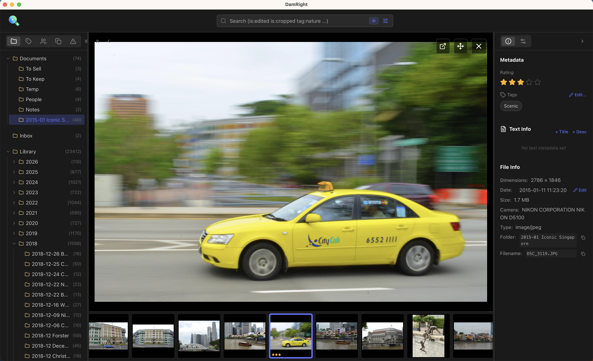
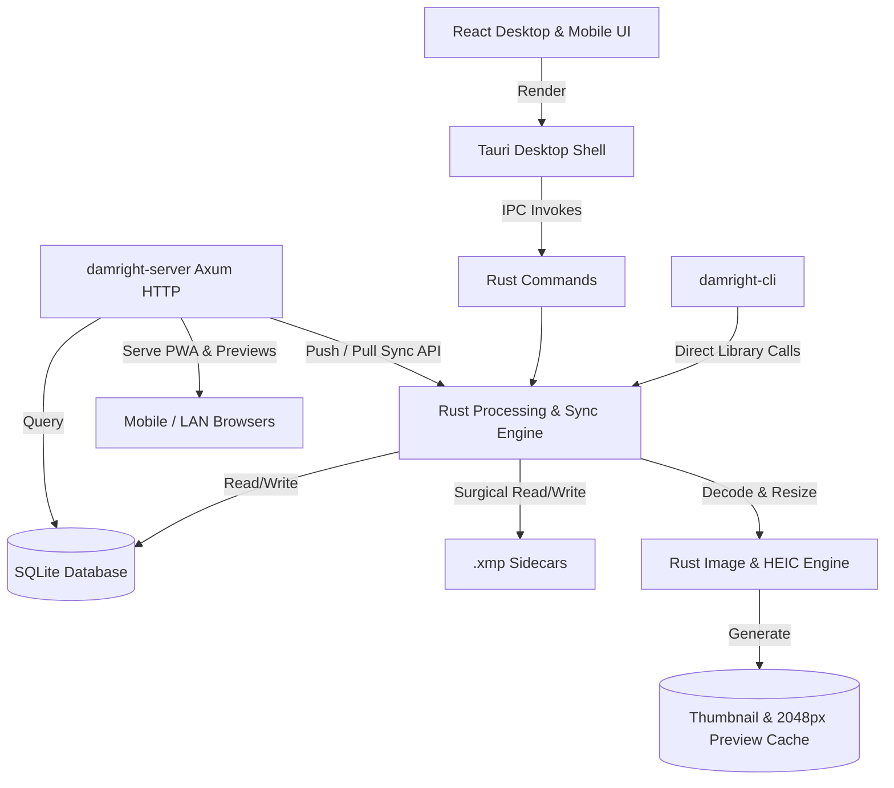

# DamRight: Personal Digital Asset Manager (DAM)

`DamRight` is a high-performance, offline-first Personal Digital Asset Manager (DAM) built with **Tauri v2**, **Rust**, and **React (TypeScript)**. It is designed to organize and curate large personal photo, video, and markdown journal libraries (10,000+ items) with non-destructive XMP sidecar editing, automated structure auditing, Elo-based photo ranking, and direct home server synchronization.



---

## 🌟 Key Features

### 📂 Library Management & Structure Auditing
- **Managed Folder Structure:** Organizes media into consistent date-based folders (`/YYYY/MM-DD/` or `/YYYY/MM-DD/EventName`).
- **Format Support:** Supports JPEG, PNG, HEIC/HEIF (including multi-tile iPhone portrait photos with depth maps), MP4, MOV, AVI, and Markdown (`.md`) journal entries.
- **Deterministic Auto-Renaming:** Standardizes filenames using capture timestamp and a collision-resistant Blake3 content hash prefix: `YYYYMMDDTHHMMSS-{3-char-hash}.ext`.
- **Validation & Auto-Fix Suite:** Integrated sidebar audit panel detects missing events, missing capture times, misplaced date folders, or non-standard filenames, with one-click batch repair.

### 🎨 Non-Destructive Editing & XMP Sidecars
- **Golden Source Principle:** Original media files are **never** modified.
- **SQLite Index:** High-speed queryable index caches metadata, face regions, perceptual hashes, and edit states.
- **Adobe-Compatible XMP Sidecars:** Ratings, tags, titles, descriptions, events, capture dates, crops, exposure adjustments, and face regions (`mwg-rs:Regions`) are synchronized to standard `.xmp` sidecar files.
- **Interactive Adjustments:** Non-destructive exposure, portrait depth blur (using embedded HEIC depth maps), crop, and 90° rotation.

### 🏆 Curation, Elo Photo Rater & Duplicate Detection
- **Elo Photo Rater (`RaterView`):** Curate your library via head-to-head (1v1) duels or **Best of 4** quad matches powered by an Elo proximity matchmaking engine, then apply suggested 1–5 star ratings in batch.
- **Perceptual Duplicate Detection (`DuplicatesView`):** Uses gradient perceptual hashing (`image_hasher`) to group visually identical or near-duplicate photos side by side for quick culling.
- **iCloud Photos Diff (macOS):** Compare your local curated library against the macOS `Photos.app` library via JXA (`osascript`) and collect rejected photos into a `DamRight Rejected` album for easy cleanup.

### 🖥️ Three-in-One Architecture: Desktop, Home Server & CLI
1. **Tauri Desktop App (`damright`):** Full-featured desktop workflow with keyboard shortcuts, multi-select batch editing, filmstrip view, timeline views (`Years` / `Months` / `All`), and Ken Burns slideshow.
2. **Home Server & Mobile Web App (`damright-server`):** Standalone Axum HTTP server (`PORT=8010`) that serves a mobile-friendly PWA (`WebApp.tsx`) for browsing, timeline scrubbing, and full-screen slideshows across your LAN/Tailscale network, plus endpoints for multi-device push/pull folder sync.
3. **Command-Line Interface (`damright-cli`):** Scriptable CLI for querying tags/photos, batch-editing metadata and XMP sidecars, and running or dry-running home server syncs (`--dry-run`, `--json`).

---

## 🛠️ Architecture



---

## 🚀 Getting Started

### Prerequisites
- **Node.js** (v20+) and `npm`
- **Rust** (stable toolchain via `rustup`)
- Platform dependencies for [Tauri v2](https://v2.tauri.app/start/prerequisites/)

### 1. Install Dependencies
```bash
npm install
```

### 2. Run Desktop App in Development Mode
```bash
npm run tauri dev
```

### 3. Run Standalone Home Server & Web UI
Build the frontend assets and launch `damright-server` (listens on `http://0.0.0.0:8010` by default):
```bash
npm run server
```
Environment variables supported by `damright-server`:
- `PORT`: HTTP port (default: `8010`)
- `DAMRIGHT_DATA_DIR`: Directory for `damright.db` and preview `cache/` (defaults to system app data directory `com.damright.app`)
- `DAMRIGHT_STORAGE_DIR`: Root directory for synced photo storage on the server

> **Security Note:** `damright-server` is designed for trusted local networks (LAN) or private mesh VPNs (such as Tailscale/WireGuard). Do not expose port `8010` directly to the public internet without an authenticating reverse proxy.

### 4. Use the CLI (`damright-cli`)
```bash
# Show help and available subcommands
npm run cli -- help

# List all tags with at least 5 photos
npm run cli -- tags --min-count 5

# Search photos by query and output JSON
npm run cli -- photos --query "tag:vacation rating:>=4" --json

# Dry-run a metadata edit
npm run cli -- edit --query "tag:trip" --add-tag "summer" --dry-run

# Preview home server sync plan without transferring files
npm run cli -- sync --dry-run
```

### 5. macOS Local Installation (`install.sh`)
On macOS, you can build the release `.app` bundle and `damright-cli` binary and install them to `/Applications/DamRight.app` and `/usr/local/bin/damright-cli`:
```bash
./install.sh
```

---

## 🧪 Testing & Verification

Every feature, bug fix, or refactor must pass the unified validation suite before completion:

```bash
npm run validate
```

This runs all 5 checks in sequence:
1. **Frontend Build & Type Check:** `tsc && vite build`
2. **Frontend Unit Tests:** `vitest --run`
3. **Frontend E2E Tests:** `playwright test`
4. **Backend Rust Check:** `cargo check`
5. **Backend Rust Tests:** `cargo test`

---

## 📄 License

Licensed under the [MIT License](./LICENSE).
