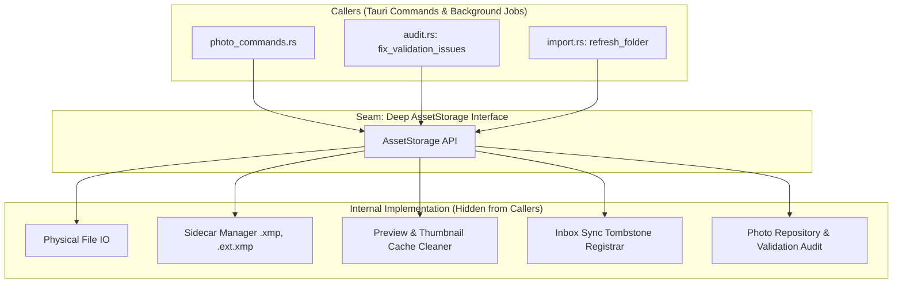

# DamRight: Deep `AssetStorage` Module Architecture & Implementation Spec

This document is the engineering hand-off specification for designing and implementing the **`AssetStorage`** module in DamRight. For the frontend shell architecture, see [`docs/prds/UNIFIED-SHELL-SPEC.md`](./UNIFIED-SHELL-SPEC.md).

---

## 1. Context & Motivation

### Core Mandate
In DamRight, the **local file system and `.xmp` sidecars are the golden source of truth**. The SQLite database serves as a high-speed cache and query engine. Original media assets and sidecars must never be orphaned, desynchronized, or corrupted.

### The Problem: Shallow & Scattered Physical Operations
Currently, physical asset manipulation logic is scattered across multiple backend files:
- [`src-tauri/src/processing/file_ops.rs`](../../src-tauri/src/processing/file_ops.rs)
- [`src-tauri/src/processing/metadata/xmp.rs`](../../src-tauri/src/processing/metadata/xmp.rs)
- [`src-tauri/src/processing/import.rs`](../../src-tauri/src/processing/import.rs)
- [`src-tauri/src/processing/audit.rs`](../../src-tauri/src/processing/audit.rs)
- [`src-tauri/src/commands/photo_commands.rs`](../../src-tauri/src/commands/photo_commands.rs)

#### Key Inconsistencies & Duplications:
1. **Duplicate Deletion Pipelines**: [`delete_photo_by_id`](../../src-tauri/src/processing/file_ops.rs#L446-L487) and [`delete_rejected_in_folder`](../../src-tauri/src/processing/file_ops.rs#L317-L361) contain 100% identical 30-line code blocks that manually delete raw files, search and delete `.xmp` and `.<ext>.xmp` sidecars, locate the thumbnail cache dir, delete cached cropped/uncropped previews, mark sync inbox tombstones, and delete records from SQLite.
2. **Scattered Sidecar Resolution**: The pattern `vec![path.with_extension(format!("{}.xmp", ext)), path.with_extension("xmp")]` is re-declared across 8 distinct functions in `xmp.rs`, `file_ops.rs`, and `import.rs`.
3. **Inconsistent Collision & Suffix Handling**: File moving in [`move_photos`](../../src-tauri/src/processing/file_ops.rs#L363-L444) uses numeric suffixes `_1`, `_2`, while renaming in [`auto_rename_photo`](../../src-tauri/src/processing/file_ops.rs#L171-L241) uses timestamp + content hashes. Sidecar renaming logic differs in string containment checks.

---

## 2. Deep Module Architecture



### Architectural Principles
- **Small Interface, Deep Implementation**: Callers only request high-level operations (`delete`, `move`, `rename`, `auto_rename`). The module encapsulates all 5 side-effects (Raw File, Sidecars, Thumbnails, Previews, DB + Tombstones).
- **Golden Invariant**: File operations must be atomic within transactions where possible. A physical move/rename must never leave behind orphan sidecars or stale previews.
- **The Interface is the Test Surface**: Unit and integration tests test `AssetStorage` directly with a real filesystem and SQLite connection without requiring a running Tauri webview context.

---

## 3. Interface Design (`src-tauri/src/processing/storage.rs`)

Create a new deep module at `src-tauri/src/processing/storage.rs`:

```rust
use std::path::{Path, PathBuf};
use rusqlite::Connection;
use crate::models::Photo;

pub struct AssetStorage;

impl AssetStorage {
    /// Delete a single photo and all associated assets (raw media, all XMP sidecars,
    /// thumbnail, cropped/uncropped cached previews, and DB record).
    /// Automatically records an inbox tombstone if the file is within a pull sync source.
    pub fn delete_photo(conn: &Connection, id: &str) -> anyhow::Result<()>;

    /// Delete all rejected photos under a specific folder path prefix.
    /// Returns the number of photos deleted.
    pub fn delete_rejected_in_folder(conn: &Connection, folder_path: &str) -> anyhow::Result<usize>;

    /// Move a batch of photos by ID to a destination folder.
    /// Handles collision detection, companion XMP sidecar moves/renames,
    /// sync tombstones, DB path updates, and audit re-validation.
    /// Returns the number of successfully moved photos.
    pub fn move_photos(conn: &Connection, ids: &[String], dest_folder: &str) -> anyhow::Result<usize>;

    /// Rename a single photo to a specific new filename.
    /// Moves and updates the primary media file, preserves original filename in XMP,
    /// renames companion sidecars, updates DB path, and triggers re-validation.
    pub fn rename_photo(conn: &Connection, id: &str, new_filename: &str) -> anyhow::Result<String>;

    /// Auto-rename a photo according to the deterministic convention:
    /// `YYYYMMDDTHHMMSS-{3-char-hash}.ext` based on DateTimeOriginal and content hash.
    pub fn auto_rename_photo(conn: &Connection, id: &str) -> anyhow::Result<String>;

    /// Auto-rename all photos under a specific directory prefix.
    pub fn auto_rename_folder(conn: &Connection, folder_path: &str) -> anyhow::Result<usize>;

    /// Discover all existing XMP sidecars associated with a media file.
    /// Checks both standard `{file}.xmp` and Adobe-style `{file}.{ext}.xmp`.
    pub fn find_sidecars(media_path: &Path) -> Vec<PathBuf>;

    /// Clean up cached thumbnails and previews (both cropped and uncropped) for a given photo.
    pub fn cleanup_preview_cache(thumb_path: &str, raw_path: &str) -> anyhow::Result<()>;
}
```

---

## 4. Internal Implementation Mechanics

### 4.1 Sidecar Discovery & Relocation
When renaming or moving an asset:
1. Locate all candidate sidecars using `find_sidecars(path)`:
   - `<dir>/<stem>.<ext>.xmp` (e.g. `IMG_001.JPG.xmp`)
   - `<dir>/<stem>.xmp` (e.g. `IMG_001.xmp`)
2. When moving to `dest_folder`, maintain matching naming:
   - If image renamed to `new_stem.ext`, `<dir>/<stem>.<ext>.xmp` becomes `<dest_folder>/<new_stem>.<ext>.xmp`.
   - `<dir>/<stem>.xmp` becomes `<dest_folder>/<new_stem>.xmp`.
3. Before renaming an asset, preserve the original filename into the XMP sidecar via `crate::processing::metadata::xmp::write_preserved_filename`.

### 4.2 Cache & Preview Cleanup
Preview and thumbnail cleanup must resolve both legacy and structured thumbnail paths:
```rust
pub fn cleanup_preview_cache(thumb_path_str: &str, raw_path_str: &str) -> anyhow::Result<()> {
    let thumb_path = Path::new(thumb_path_str);
    if thumb_path.exists() {
        let _ = std::fs::remove_file(thumb_path);
    }

    let cache_dir = if thumb_path_str.contains("thumbnails") {
        thumb_path.parent().and_then(|p| p.parent()).and_then(|p| p.parent())
    } else {
        thumb_path.parent()
    };

    if let Some(cache_dir) = cache_dir {
        let preview_path = crate::processing::image::get_preview_path(raw_path_str, cache_dir, false);
        let _ = std::fs::remove_file(preview_path);
        let uncropped_preview_path = crate::processing::image::get_preview_path(raw_path_str, cache_dir, true);
        let _ = std::fs::remove_file(uncropped_preview_path);
    }
    Ok(())
}
```

### 4.3 Inbox Tombstone Sync Integration
Whenever an asset is moved or deleted:
- Call `mark_inbox_tombstone_if_needed(conn, current_path_str, "deleted")` (for deletions) or `"sorted"` (for moves/renames).

---

## 5. Step-by-Step Implementation Plan

### Step 1: Create `src-tauri/src/processing/storage.rs`
- Implement `AssetStorage` with `find_sidecars`, `cleanup_preview_cache`, `delete_photo`, `delete_rejected_in_folder`, `move_photos`, `rename_photo`, `auto_rename_photo`, and `auto_rename_folder`.
- Expose `pub mod storage;` in `src-tauri/src/processing/mod.rs`.

### Step 2: Update `src-tauri/src/processing/metadata/xmp.rs`
- Replace duplicated inline sidecar resolution `vec![path.with_extension(format!("{}.xmp", ext)), path.with_extension("xmp")]` with `crate::processing::storage::AssetStorage::find_sidecars(path)`.

### Step 3: Refactor `src-tauri/src/commands/photo_commands.rs`
- Delegate Tauri commands directly to `AssetStorage`:
  - `delete_photo` -> `AssetStorage::delete_photo(&tx, &id)`
  - `delete_rejected` -> `AssetStorage::delete_rejected_in_folder(&tx, &folder_path)`
  - `auto_rename` -> `AssetStorage::auto_rename_photo` / `auto_rename_folder`
  - `move_photos` -> `AssetStorage::move_photos(&tx, &ids, &dest_folder)`

### Step 4: Refactor `src-tauri/src/processing/audit.rs`
- In `fix_validation_issues`, replace direct calls to `file_ops` with `AssetStorage::move_photos` and `AssetStorage::auto_rename_photo`.

### Step 5: Clean Up Redundant Code in `file_ops.rs`
- Deprecate or redirect old copy-pasted implementations in `file_ops.rs` to `AssetStorage` to avoid breaking external callers.

### Step 6: Add Comprehensive Automated Tests
In `src-tauri/src/processing/tests.rs` (or `storage_tests.rs`):
- **Test 1 (`test_delete_photo_lifecycle`)**: Create photo with `.jpg`, `.jpg.xmp`, thumbnail, and preview files -> call `AssetStorage::delete_photo` -> verify all physical files and DB records are removed.
- **Test 2 (`test_move_photo_with_multi_sidecars`)**: Create photo with `.jpg`, `.jpg.xmp`, and `.xmp` -> call `AssetStorage::move_photos` to new directory -> verify both sidecars moved correctly and DB path updated.
- **Test 3 (`test_auto_rename_preserves_sidecar_and_metadata`)**: Create photo with EXIF capture time -> call `auto_rename_photo` -> verify deterministic name format `YYYYMMDDTHHMMSS-{hash}.jpg` and sidecar renamed in sync.

### Step 7: Mandatory Verification Suite
Run the full project verification suite:
```bash
npm run validate
```
This must exit with code 0 (TypeScript check, Vitest tests, Playwright E2E tests, `cargo check`, `cargo test`).

---

## 6. Acceptance Criteria

- [ ] All file deletion, move, and rename logic in `photo_commands.rs`, `file_ops.rs`, and `audit.rs` passes exclusively through `AssetStorage`.
- [ ] No duplicated sidecar discovery loops exist across `xmp.rs`, `file_ops.rs`, and `import.rs`.
- [ ] Preview cache (cropped + uncropped) and thumbnail cleanup are guaranteed on every deletion.
- [ ] Preserved filename in XMP is retained prior to any auto-rename.
- [ ] Sync inbox tombstones are reliably registered on moves and deletions.
- [ ] `cargo test` passes with new test coverage for `AssetStorage`.
- [ ] `npm run validate` runs cleanly with zero regressions.
