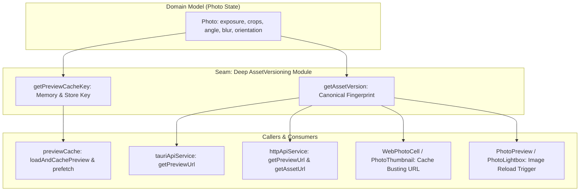

# DamRight: Asset Versioning & Preview Cache Invalidation Spec

This document is the engineering hand-off specification for unifying non-destructive edit fingerprinting, image versioning, and cache invalidation across the frontend and backend.

---

## 1. Context & Motivation

### Core Mandate
In DamRight, all adjustments (exposure, portrait blur, crop bounds, rotation angle, and EXIF orientation) are **non-destructive**. When an adjustment is modified, cached thumbnails, preview URLs, and browser image caches must update immediately without requiring manual app reloads or leaving stale previews in memory.

### The Problem: Asymmetric Cache Keys & Stale Previews
Currently, cache fingerprinting is implemented inconsistently across 4 separate files:

1. **Missing Attributes in `previewCache.ts`**:
   In [`src/utils/previewCache.ts`](../../src/utils/previewCache.ts#L7-L10):
   ```typescript
   export function getPreviewCacheKey(photo: Photo, uncropped: boolean = false): string {
     const cropKey = `${photo.crop_top ?? ""}_${photo.crop_left ?? ""}_${photo.crop_bottom ?? ""}_${photo.crop_right ?? ""}_${photo.crop_angle ?? ""}`;
     return `${photo.id}:${uncropped ? "uncropped" : "cropped"}:${cropKey}:${photo.exposure ?? 0}`;
   }
   ```
   Notice that `portrait_blur` and `orientation` are **completely omitted**!
   If a user applies portrait blur or fixes photo orientation in the desktop app, `previewCache` continues returning the old unblurred/unrotated cached blob because the key didn't change.

2. **Divergent String Formats in HTTP & Web**:
   - In [`src/services/httpApiService.ts`](../../src/services/httpApiService.ts#L41-L55) and [`src/WebApp.tsx`](../../src/WebApp.tsx#L46-L58), version strings are constructed as:
     `[exposure, crop_top, crop_left, crop_bottom, crop_right, crop_angle, portrait_blur, orientation].filter((v) => v !== undefined && v !== null && v !== 0).join("_")`.
   - In [`src/components/common/PhotoPreview.tsx`](../../src/components/common/PhotoPreview.tsx), an inline key is used for React re-render tracking.

---

## 2. Deep Module Architecture



### Architectural Principles
- **Single Source of Truth**: All edit attributes (`exposure`, `crop_top`, `crop_left`, `crop_bottom`, `crop_right`, `crop_angle`, `portrait_blur`, `orientation`) are evaluated in a single pure function.
- **Isomorphic Fingerprint**: The exact same version string format is passed in HTTP URL query parameters (`?v=...`), desktop IPC cache lookups, and React component props.
- **Fail-Safe Invalidation**: Adding any new non-destructive edit attribute in the future requires modifying only this one module.

---

## 3. Interface Design (`src/utils/assetVersion.ts`)

Create a dedicated module at `src/utils/assetVersion.ts`:

```typescript
import { Photo } from "../types";

export interface AssetVersionOptions {
  uncropped?: boolean;
}

/**
 * Generate a deterministic version string fingerprint representing
 * all non-destructive adjustments applied to a photo.
 */
export function getAssetVersion(photo: Photo, options?: AssetVersionOptions): string {
  if (options?.uncropped) {
    // Uncropped previews only care about exposure and portrait blur
    const uncroppedParts = [
      photo.exposure ?? 0,
      photo.portrait_blur ?? 0,
    ];
    return `uncropped_${uncroppedParts.join("_")}`;
  }

  const parts = [
    photo.exposure ?? 0,
    photo.crop_top ?? "",
    photo.crop_left ?? "",
    photo.crop_bottom ?? "",
    photo.crop_right ?? "",
    photo.crop_angle ?? "",
    photo.portrait_blur ?? 0,
    photo.orientation ?? 1,
  ];

  return parts.join("_");
}

/**
 * Generate a unique in-memory cache key for preview caching.
 */
export function getPreviewCacheKey(photo: Photo, uncropped: boolean = false): string {
  const version = getAssetVersion(photo, { uncropped });
  return `${photo.id}:${version}`;
}
```

---

## 4. Step-by-Step Implementation Plan

### Step 1: Create `src/utils/assetVersion.ts`
- Implement `getAssetVersion` and `getPreviewCacheKey`.
- Export from `src/utils/index.ts` (or import directly from `assetVersion.ts`).

### Step 2: Refactor `src/utils/previewCache.ts`
- Delegate cache key calculation to `getPreviewCacheKey(photo, uncropped)`.
- Ensure `clearPreviewCache(photoId)` reliably invalidates all versions of a specific photo.

### Step 3: Refactor `httpApiService.ts` and `tauriApiService.ts`
- In `getPreviewUrl` and `getAssetUrl`, replace inline version string construction with `getAssetVersion(photo, { uncropped })`.

### Step 4: Refactor `PhotoPreview.tsx`, `PhotoThumbnail.tsx`, and `WebApp.tsx`
- Replace ad-hoc version string formatting in `WebPhotoCell` and thumbnail components with `getAssetVersion(photo)`.

### Step 5: Add Automated Unit Tests
In `src/test/previewCache.test.ts` and new `src/test/assetVersion.test.ts`:
- Verify changing `portrait_blur` changes the cache key and triggers cache invalidation.
- Verify changing `orientation` changes the cache key.
- Verify uncropped version flag produces isolated cache keys.

### Step 6: Mandatory Verification Suite
```bash
npm run validate
```

---

## 5. Acceptance Criteria

- [ ] Modifying `portrait_blur` or `orientation` immediately changes the generated preview cache key.
- [ ] No duplicated `[exposure, crop_top, ...].join("_")` logic exists across `httpApiService.ts`, `WebApp.tsx`, and `previewCache.ts`.
- [ ] All Vitest tests in `previewCache.test.ts` pass cleanly.
- [ ] `npm run validate` exits with code 0.
