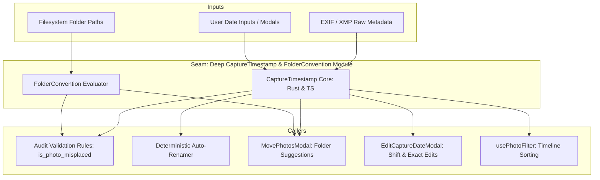

# DamRight: Domain `CaptureTimestamp` & Folder Convention Spec

This document is the engineering hand-off specification for unifying capture timestamp parsing, deterministic filename prefixes, and folder date conventions across the Rust backend and TypeScript frontend.

---

## 1. Context & Motivation

### Core Mandate
In DamRight, media organization relies on deterministic naming (`YYYYMMDDTHHMMSS-{hash}.ext`) and structured date-based directories (`/YYYY/MM-DD/` or `/YYYY/MM-DD Event/`). A photo is flagged as **misfiled** by the validation audit if:
- It lacks a capture time.
- Any date-formatted folder in its path (`YYYY`, `YYYY-MM`, `YYYY-MM-DD`) does not match the actual capture date.
- Its filename timestamp prefix does not match the capture date/time.

### The Problem: Fragmented, Brittle Date Slicing & Parsing
Currently, date parsing and convention validation are scattered with incompatible implementations:

1. **Brittle Backend String Slicing**:
   In [`src-tauri/src/processing/audit.rs`](../../src-tauri/src/processing/audit.rs#L152-L156):
   ```rust
   let ct_year = &capture_time[0..4];
   let ct_month = &capture_time[5..7];
   let ct_day = &capture_time[8..10];
   ```
   This code assumes `capture_time` is formatted with fixed byte lengths. If a timestamp contains an ISO `T`, fractional seconds, or a timezone offset (e.g. `2024-06-09T19:25:23+01:00`), it either panics or falsely flags correctly organized photos as misfiled.

2. **Frontend Inconsistencies**:
   - In [`MovePhotosModal.tsx`](../../src/components/common/MovePhotosModal.tsx#L30-L42), folder suggestions parse dates using custom regexes and fallback to `new Date()`.
   - In [`EditCaptureDateModal.tsx`](../../src/components/common/EditCaptureDateModal.tsx#L271-L292), four separate manual formatting helpers convert between input `<input type="datetime-local">`, DB strings, and JS `Date` instances.
   - In [`pathUtils.ts`](../../src/utils/pathUtils.ts), date folder parsing regexes differ slightly from backend `audit.rs`.

---

## 2. Deep Module Architecture



### Architectural Principles
- **Single Canonical Representation**: Internally, timestamps are parsed into a normalized `NaiveDateTime` (Rust) or ISO standard (TS) representation.
- **Isomorphic Convention Invariants**: A folder path considered valid by `FolderConvention` in the frontend modal suggestion will **always** pass `audit.rs` validation in the backend.
- **Fail-Safe Parsing**: Handles ISO 8601, RFC 3339, EXIF colons (`YYYY:MM:DD HH:MM:SS`), space-separated strings, and timezone offsets gracefully.

---

## 3. Interface Design

### 3.1 Rust: `src-tauri/src/processing/date_conventions.rs`

```rust
use chrono::{NaiveDate, NaiveDateTime};
use std::path::Path;

#[derive(Debug, Clone, PartialEq, Eq)]
pub struct CaptureTimestamp {
    dt: NaiveDateTime,
}

impl CaptureTimestamp {
    /// Robustly parse any datetime string format (ISO 8601, EXIF, DB, RFC 3339)
    pub fn parse(s: &str) -> Option<Self>;

    pub fn from_naive(dt: NaiveDateTime) -> Self;

    /// Canonical DB format: "YYYY-MM-DD HH:MM:SS"
    pub fn to_db_string(&self) -> String;

    /// Deterministic filename prefix: "YYYYMMDDTHHMMSS"
    pub fn to_filename_prefix(&self) -> String;

    pub fn year(&self) -> i32;
    pub fn month(&self) -> u32;
    pub fn day(&self) -> u32;
    pub fn date(&self) -> NaiveDate;
}

pub struct FolderConvention;

impl FolderConvention {
    /// Check if a folder name matches YYYY, YYYY-MM, or YYYY-MM-DD
    pub fn parse_date_component(folder_name: &str) -> Option<FolderDatePattern>;

    /// Check whether a path conforms to the capture timestamp
    pub fn is_folder_misplaced(path: &Path, capture_time: &CaptureTimestamp) -> bool;

    /// Generate the canonical suggested relative path: "YYYY/MM-DD EventName" or "YYYY/MM-DD"
    pub fn suggest_folder_path(capture_time: Option<&CaptureTimestamp>, event: Option<&str>) -> String;
}

#[derive(Debug, PartialEq, Eq)]
pub enum FolderDatePattern {
    Year(i32),
    YearMonth(i32, u32),
    YearMonthDay(i32, u32, u32),
}
```

### 3.2 TypeScript: `src/utils/dateConventions.ts`

```typescript
export interface ParsedCaptureDate {
  year: string;
  month: string;
  day: string;
  hour: string;
  minute: string;
  second: string;
  dbString: string;       // "YYYY-MM-DD HH:MM:SS"
  inputString: string;    // "YYYY-MM-DDTHH:MM"
  filenamePrefix: string; // "YYYYMMDDTHHMMSS"
}

export function parseCaptureDate(dateStr?: string | null): ParsedCaptureDate | null;
export function formatCaptureDateForInput(dateStr?: string | null): string;
export function formatInputToDbDate(inputVal: string): string;
export function getSuggestedFolderName(parentPath: string | null, captureTime?: string | null, event?: string | null): string;
```

---

## 4. Step-by-Step Implementation Plan

### Step 1: Create `src-tauri/src/processing/date_conventions.rs`
- Implement `CaptureTimestamp` with multi-format parsing.
- Implement `FolderConvention` with date component regex matching (`YYYY`, `YYYY-MM`, `YYYY-MM-DD`).
- Expose in `src-tauri/src/processing/mod.rs`.

### Step 2: Refactor `src-tauri/src/processing/audit.rs`
- Replace rigid substring slicing in `is_name_misplaced` and `is_folder_misplaced` with `CaptureTimestamp::parse` and `FolderConvention::is_folder_misplaced`.
- Replace manual folder recreation logic in `fix_validation_issues` with `FolderConvention`.

### Step 3: Create `src/utils/dateConventions.ts`
- Implement robust parsing, date formatting, and canonical folder name generation.
- Refactor `EditCaptureDateModal.tsx` and `MovePhotosModal.tsx` to consume `dateConventions.ts`.

### Step 4: Add Automated Unit Tests
- In Rust: Add tests verifying parsing of ISO dates with timezones, EXIF colons, dates with fractional seconds, and various folder patterns (`2024`, `2024-05`, `2024-05-13`, `2024-05-13 Summer Party`).
- In Frontend: Add tests in `src/test/dateConventions.test.ts` verifying modal inputs, shifts, and folder suggestions.

### Step 5: Run Mandatory Verification Suite
```bash
npm run validate
```

---

## 5. Acceptance Criteria

- [ ] Zero substring-slice panics in `audit.rs` on unusual or timezone-annotated timestamps.
- [ ] Folder suggestion in `MovePhotosModal` produces folders guaranteed to pass backend audit rules.
- [ ] Date input conversions in `EditCaptureDateModal` pass through `dateConventions.ts`.
- [ ] `npm run validate` exits with code 0.
