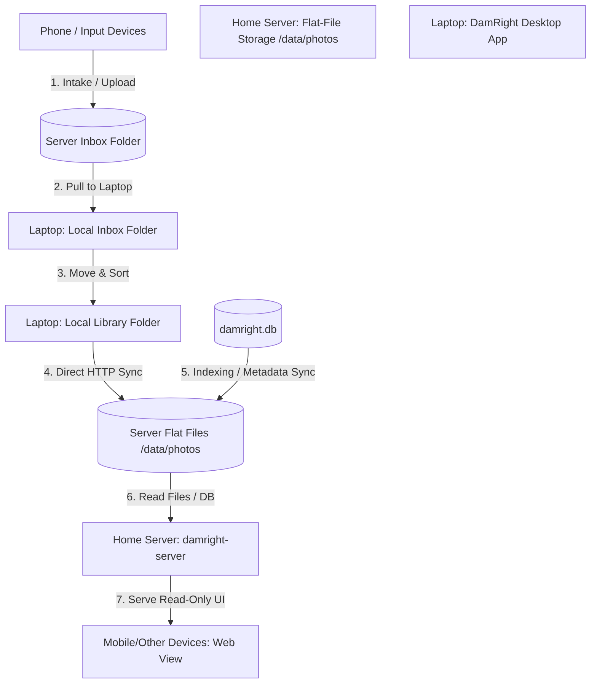

# DamRight: Multi-Device Sync, Inbox Triage, and Read-Only Web View Spec

This document details the functional and technical specifications for implementing the multi-device workflow, automated home server inbox pull, library synchronization, and the read-only web view deployment for `DamRight`.

---

## 1. Overview & Objective

The objective is to expand `DamRight` from a standalone local photo manager into a multi-device personal digital asset management system. 

### Core Workflow Goals
1. **Seamless Intake**: Ingest photos into a central inbox on a home server.
2. **Local Management**: Pull new photos to the laptop for fast sorting, editing, metadata tagging, and renaming.
3. **Automated Protection**: Automatically sync sorted library photos to the home server for long-term flat-file storage and local viewing.
4. **Universal Browsing**: Expose a responsive, read-only web interface from the home server to browse the entire library from any local device or phone.

---

## 2. Architecture & Data Flow



### Device Roles
* **Laptop (Golden Source)**: Stores the primary library inside local media directories. Runs the desktop Tauri/React application, pulling new files, managing the SQLite index, performing crops/edits, and orchestrating sync processes.
* **Home Server**: Hosts standard flat-file media storage in `/data/photos` and runs the `damright-server` binary to provide HTTP sync API endpoints and a read-only browsing interface.

---

## 3. Core Functional Specifications

### 3.1 Mobile Inbox & Server Intake
* Media files uploaded or transferred to the home server are ingested into `/data/photos/Inbox`.

### 3.2 Inbox Pull
* The DamRight desktop app automatically checks the server's `/data/photos/Inbox` folder, pulling unsorted photos down to the laptop's local `Inbox` directory for sorting.
* When clicked, the backend:
  1. Establishes a connection to the `damright-inbox` S3 bucket.
  2. Downloads all files that are not already present in the local database or local storage.
  3. Writes downloaded files to a local `Inbox/` directory under the main library folder (e.g., `[LibraryPath]/Inbox/`).
  4. Moves the downloaded files in the S3 bucket from the inbox path to an `archive/` prefix (e.g., `archive/YYYY-MM/`) to empty the active inbox and prevent repeated downloads.
* If a network or transfer error occurs, the pull fails gracefully, reporting the error to the user without archiving partially transferred files.

### 3.3 Triage & Sorting (Move Photo)
* The local `Inbox/` folder is indexed and displayed as a standard directory in the sidebar treeview.
* The user reviews files in `Inbox/` using the standard grid view.
* The user files photos using the existing **Move Photo...** context menu command, which suggests target directories (e.g. `/YYYY/MM-DD/EventName`) based on capture dates and folder rules.
* Once moved out of the `Inbox/` directory, files conform to the project's standard organization structure.

#### 3.4 Laptop to Home Server Sync (Debounced & Incremental)
* Any file operations that modify the library (e.g., moving files, editing capture dates, setting events, crop/exposure edits, renaming) trigger a synchronization process.
* **Debouncing Mechanism**: To avoid frequent, high-overhead S3 connections while editing multiple files:
  - The sync is debounced by **30 minutes** by default (user configurable from 1 to 120 minutes).
  - Any edit resets the timer. When the configured duration passes with no edits, the sync automatically begins.
  - A **Sync Now** button in the UI allows instant execution at any time.
* **Synchronized Assets**:
  - Original library media files and their `.xmp` sidecars are synchronized to the main library bucket on the Home Server (`damright-library`).
  - Thumbnail caches and SQLite `.db` files are **not** transferred across the network.
* **Incremental Sync & Local Sync State**:
  - To prevent unnecessary S3 HEAD requests for thousands of unchanged files, sync state is tracked in a local SQLite table `sync_state` (`relative_path`, `file_size`, `mtime`, `hash`, `last_synced_at`, `status`).
  - Only files created or modified since `last_synced_at` are queued and uploaded.
* **Sync Completion Notification**:
  - Upon completing a sync batch, the laptop sends a lightweight `POST /api/sync/notify` request to the Home Server containing the list of updated relative paths `["2026/08-04/DSC0001.xmp"]`.
* **Golden Source Principle**:
  - The laptop acts as the absolute **golden source** (one-way sync laptop -> home server).

---

### 3.5 Cloud Backup (OneDrive Integration)
* By designating a directory within the local OneDrive sync folder as the DamRight main library path, cloud backup is delegated entirely to the native OneDrive sync engine.
* No OneDrive API or credential management is needed in the DamRight codebase.

---

### 3.6 Home Server Read-Only Web Server & XMP Indexer
* The Home Server runs the standard `damright` binary in headless server mode:
  ```bash
  ./damright --server
  ```
* **XMP-Driven Server Indexing**:
  - The Home Server maintains its own local `damright.db` in WAL mode.
  - When notified via `POST /api/sync/notify` (or via its local `notify` filesystem event watcher), the server reads the updated `.xmp` sidecars directly and updates its local SQLite index instantly.
  - This eliminates database lock conflicts, avoids path mapping issues, and prevents database transfer overhead.
* **Dynamic Preview Generation**:
  - The server generates thumbnails and previews on demand when requested by web/mobile clients, caching them locally in the server's cache directory (`~/.cache/damright/previews`).
  - Keeps S3 sync payloads minimal (no uploading thousands of small thumbnail files).
* **Path Portability**:
  - Relative photo paths stored in `damright.db` are resolved dynamically relative to the Home Server's configured source root directory.

---

## 4. Technical Specifications

### 4.1 Local JSON Configuration (`config.json`)
Global server connection settings are stored in the App Data Directory (`~/.config/damright/config.json` on Unix/macOS or `%APPDATA%\damright\config.json` on Windows):

```json
{
  "server_sync": {
    "endpoint": "http://192.168.1.100:8010",
    "enabled": true,
    "debounce_minutes": 30
  },
  "local": {
    "web_port": 8010
  }
}
```

### 4.2 Unified Database Sources & Portable Schema
All library folders and their associated sync behaviors are unified inside the SQLite `sources` database table:
```sql
CREATE TABLE IF NOT EXISTS sources (
    id TEXT PRIMARY KEY,
    path TEXT NOT NULL,
    name TEXT NOT NULL,
    sync_mode TEXT NOT NULL DEFAULT 'none', -- 'push', 'pull', or 'none'
    server_path TEXT,
    archive_prefix TEXT
);
```

Per-folder sync modes:
- **`push`**: Scans local media directory and backs up photos/XMPs to the server (`server_path`).
- **`pull`**: Downloads remote photos from server (`server_path`) to the local inbox directory.
- **`none`**: Local-only folder indexing (no server backup).
* **Current Schema**: The `photos` table stores relative paths in `path` and `source_id` referencing `sources`.
* **Path Resolution**: Relative photo paths are joined with the Source Root path dynamically.
* **Sync State Schema**:
  ```sql
  CREATE TABLE IF NOT EXISTS sync_state (
      relative_path TEXT PRIMARY KEY,
      file_size INTEGER NOT NULL,
      mtime INTEGER NOT NULL,
      hash TEXT,
      last_synced_at TEXT NOT NULL,
      status TEXT NOT NULL
  );
  ```

### 4.3 Sync Execution & Server Re-indexing Workflow
1. **Debounce Logic & Sync Engine**:
   - A background Tokio task runs an event loop listening to sync triggers (`LibraryModified`, `SyncNow`, `Cancel`).
   - `LibraryModified` sets or resets a countdown timer for `debounce_minutes`.
   - When the countdown reaches 0 (or `SyncNow` is invoked):
     a. Scans local source directories for media files and `.xmp` sidecars.
     b. Compares file modification times (`mtime`) and size against `sync_state`.
     c. Uploads new or updated files to `library_s3.bucket` on the Home Server.
     d. Updates `sync_state` rows in `damright.db`.
     e. Sends `POST /api/sync/notify` with updated relative paths to the Home Server web server.
   - Broadcasts real-time progress events (`SyncProgress { stage, files_done, total_files, bytes_done, total_bytes }`) to the frontend webview via Tauri events.

### 4.4 Headless Server & Dynamic Preview Fallback
* When running with `--server`, the web server uses a cross-platform preview generation workflow.
* Since macOS's `sips` tool is unavailable on Linux servers, HEIC conversion should fall back to a Rust-native decoder (like `libheif-rs` or a bundled library) or standard CLI utilities (like `heif-convert` or `ffmpeg`) if installed on the host.

---

## 5. Implementation & Verification Plan

### Phase 1: Portable Relative Paths
1. Refactor SQLite database queries to store relative paths inside the `photos` table.
2. Update existing Tauri commands to prepend the source root when accessing files locally.
3. Add a migration script to convert existing absolute paths to relative paths.
4. Run validation check: `cargo test` and `npm run validate`.

### Phase 2: Configuration & S3 Client
1. Implement local `config.json` loading and saving in the Rust backend.
2. Integrate an S3 client (e.g., `aws-sdk-s3` or a lightweight alternative) into `src-tauri`.
3. Add the "Pull from Inbox" Tauri command and tie it to a new button in the sidebar.
4. Add the archiving mechanism on S3 post-download.

### Phase 3: Sync & Debouncing
1. Build the debounced synchronization scheduler in Rust.
2. Implement the SQLite online backup wrapper.
3. Wire up folder watches or event hooks (on file move, edits, metadata save) to trigger the sync timer.

### Phase 4: Headless Server Enhancements
1. Update `src-tauri/src/web_server.rs` to read from the portable relative path schema.
2. Implement a cross-platform preview generator fallback for HEIC/RAW on Linux hosts.
3. Add command-line flag handling in `main.rs`.

### Verification Suite
Run the full verification suite after each phase:
```bash
npm run validate
```
This ensures zero compilation errors, frontend tests pass, E2E Tauri mocks function correctly, and Rust unit tests pass.
