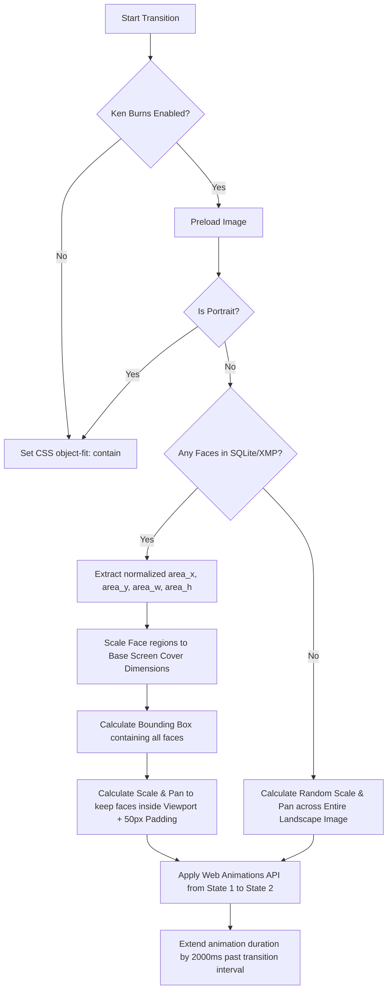

# DamRight: Slideshow Integration Specification

This document provides a detailed functional and technical specification for integrating the slideshow functionality from the standalone `photo-slideshow` repository into `DamRight`.

---

## 1. Overview & Objective

The objective is to port the features of the lightweight, Node.js-based `photo-slideshow` application into the desktop-native environment of `DamRight` (Tauri + Rust + React). 

The slideshow will run natively in a fullscreen, distraction-free view within DamRight. It features a clock, metadata overlays, keyboard overrides, and a **face-aware Ken Burns panning and zooming transition** using the lightweight `pico.js` library.

---

## 2. Core Functional Specifications (Original Behavior)

The slideshow's functionality can be divided into:
1. Backend file discovery, shuffle, metadata parsing, and HEIC conversion.
2. Frontend UI overlays (clock, metadata box).
3. Image scheduling/orchestration based on time intervals.
4. Face-aware Ken Burns transition math.

### 2.1 Backend State & Scan Logic

* **Base Directory Setup:**
  The system scans a specified folder (configured via `PICTURES_BASE`) recursively.
* **File Types:**
  Only files ending with `.jpg`, `.jpeg`, `.png`, `.webp`, `.heic`, and `.heif` are compiled.
* **Shuffle on Startup:**
  A Fisher-Yates shuffle is performed on the discovered list of absolute image paths. This order is held in memory.
* **Modulo Image Indexing:**
  To guarantee that any arbitrary slide number (either very large, or negative due to keyboard navigation overrides) maps to a valid image, the system resolves the path using a modulo operation:
  ```typescript
  let index = num % allImages.length;
  if (index < 0) {
      index = index + allImages.length;
  }
  ```
* **Date Parsing & Formatting:**
  Using EXIF metadata (read from `DateTimeOriginal` or `DateTime` tags), dates are formatted into `Day DD Month YYYY` format:
  * Input format (EXIF standard): `"2024:10:28 10:08:33"`
  * Output format: `"Sun 28 Oct 2024"`
* **Filename-to-Description Parser (`filenameToDescription`):**
  Strips folders, extensions, and standard metadata prefixes from a path to generate a clean, human-readable description:
  1. Remove base directory path.
  2. Strip file extensions.
  3. Strip `YYYY/` prefixes (folders).
  4. Strip date prefixes: `YYYY-MM-DD `, `YYYY-MM-DD-`, `YYYY-MM `, `YYYY-MM-`.
  5. Strip capture prefixes matching standard patterns: `YYYYMMDDTHHMMSS-` (e.g., DamRight's deterministic filename convention).
  6. Strip 3-character hash suffixes: `-\d{3}$`.
  7. Strip generic device filename conventions: `IMG_\d{4}`, `DCS_\d{4}`.
  8. Trim leading/trailing non-alphanumeric characters.
  
  *Example:* `/base/path/2025-02 Skiing - La Rosiere/IMG_9969.jpg` $\rightarrow$ `"Skiing - La Rosiere"`

### 2.2 HEIC Caching & Conversion

* **On-the-Fly Conversion:**
  If a requested photo is a `.heic` or `.heif` file, the backend checks a `.cache` directory for a converted JPEG version.
* **Cache Naming Convention:**
  To prevent naming collisions, the cache filename is a base64 encoding of the absolute image path, replacing `/`, `+`, and `=` with `_`:
  ```typescript
  const cacheFile = path.join(cacheDir, Buffer.from(imagePath).toString('base64').replace(/[/+=]/g, '_') + '.jpg');
  ```
* **Conversion Execution:**
  If not cached, the backend invokes the command line utility `heif-convert` synchronously:
  `heif-convert -q 85 <imagePath> <cacheFile>`

### 2.3 Frontend Layout & Orchestration

* **Viewport Settings:**
  * Background: Solid `#333` (container) and black body.
  * Canvas fills viewport: `100vw` / `100vh`.
  * Hide scrollbars and hide the cursor: `cursor: none`, `overflow: hidden`.
* **Clock Overlay:**
  * Displayed at top-left (`top: 40px`, `left: 40px`).
  * CSS: font size `65px`, light weight (`300`), white text, font `Roboto`.
  * Refreshes every 1000ms.
* **Metadata Overlay:**
  * Displayed at bottom-right (`bottom: 20px`, `right: 20px`).
  * CSS: translucent background `rgba(0, 0, 0, 0.3)`, highly rounded corners (`border-radius: 26.6px`), padding `15px`, color `rgb(153, 153, 153)`, font `Roboto Condensed` (`20px`).
  * Shows formatted date and parsed description.
* **Time-Based Scheduling:**
  * Runs an interval check every 1000ms.
  * Uses a global variable `timeOffset` (default `0`).
  * Calculates current image number:
    ```javascript
    const ts = Math.floor(Date.now() / 1000) + timeOffset;
    const newImageNum = Math.floor(ts / interval);
    ```
  * When `newImageNum` changes:
    1. Triggers asynchronous metadata fetch for the new index.
    2. Updates metadata text.
    3. Loads the image source. If Ken Burns is active, pre-loads the image to get dimensions before animating.
* **Keyboard Overrides:**
  * `ArrowRight`: Adds `interval` seconds to `timeOffset` and updates immediately (Skips forward).
  * `ArrowLeft`: Subtracts `interval` seconds from `timeOffset` and updates immediately (Skips backward).
  * `0`: Resets `timeOffset` to 0 (Syncs back to real-time).

---

### 3. The Face-Aware Ken Burns Transition

The slideshow implements a dynamic pan-and-zoom effect that ensures human faces are prioritized inside the visible viewport.



### 3.1 Face Region Coordinate Mapping
Unlike the standalone application which ran CPU-intensive client-side face detection, `DamRight` leverages face regions stored directly in the database (`photo_faces` table) and XMP sidecars. 

Each face in `photo.faces` contains normalized coordinates (ranges `0.0` to `1.0` relative to the photo's original width/height):
* `area_x` (horizontal center of face)
* `area_y` (vertical center of face)
* `area_w` (width of face region)
* `area_h` (height of face region)

These normalized coordinates are mapped to the cover image base dimensions ($baseWidth$, $baseHeight$):
* Y coordinate center: $r = \text{face.area\_y} \times baseHeight$
* X coordinate center: $c = \text{face.area\_x} \times baseWidth$
* Face size: $s = \max(\text{face.area\_w}, \text{face.area\_h}) \times baseWidth$

### 3.2 Zoom and Pan Bounds Calculation
1. **Base Cover Dimensions:**
   Calculates size variables ($baseWidth, baseHeight$) that scale the landscape image to *completely cover* the viewport aspect ratio (similar to `object-fit: cover`).
2. **Zoom Factor ($S$):**
   Adds $10\%$ to $30\%$ extra scale on top of the base cover scale:
   $$S = S_{cover} \times (1.1 + \text{random} \times 0.2)$$
3. **Translational Constraints:**
   Determines the minimum and maximum translation ranges for both axes:
   $$\text{minTx} = vw - (\text{baseWidth} \times S), \quad \text{maxTx} = 0$$
   $$\text{minTy} = vh - (\text{baseHeight} \times S), \quad \text{maxTy} = 0$$
4. **Target Panning with Faces:**
   If faces exist:
   * Determines the absolute outer bounds of all detected faces ($fLeft, fRight, fTop, fBottom$) in base dimensions:
     $$fLeft = \min(c - s/2), \quad fRight = \max(c + s/2)$$
     $$fTop = \min(r - s/2), \quad fBottom = \max(r + s/2)$$
   * Introduces $50\text{px}$ padding.
   * Computes face translation limits:
     $$\text{minTxFace} = 50 - (fLeft \times S), \quad \text{maxTxFace} = vw - 50 - (fRight \times S)$$
     $$\text{minTyFace} = 50 - (fTop \times S), \quad \text{maxTyFace} = vh - 50 - (fBottom \times S)$$
   * Determines valid intersection ranges between the image bounds and the face bounds. 
   * If a valid range exists, picks a random offset within it. If the boundaries conflict (e.g., face boundaries wider than the screen), centers the camera on the face bounding box.
5. **Target Panning without Faces (Fallback):**
   Picks a random coordinate $Tx$ and $Ty$ within the valid image limits ($[\text{minTx}, \text{maxTx}]$, $[\text{minTy}, \text{maxTy}]$).

### 3.3 CSS & Web Animation Details
* The target `` element is configured as:
  ```css
  position: absolute;
  transform-origin: 0 0;
  object-fit: fill;
  ```
* Animate from `State 1` ($\text{translate}_1$, $S_1$) to `State 2` ($\text{translate}_2$, $S_2$).
* Duration: $\text{interval} \times 1000 + 2000\text{ms}$ (allows overlap and smooth fade transition between slides).
* Easing: `ease-in-out` with `fill: forwards`.

---

## 4. DamRight Technical Integration Plan

To integrate this slideshow cleanly, we must map Node.js elements to Tauri and React architectures:

| Original System (Node.js) | DamRight Target System (Tauri / Rust / React) |
| :--- | :--- |
| **API Endpoints (`/api/*`)** | Axum HTTP server routes (`/api/photos` and `/api/preview`) |
| **Directory Scanner** | Read from SQLite Database (queried dynamically via HTTP API) |
| **HEIC Converter (`heif-convert`)** | macOS native `sips` wrapper or current DamRight backend image converter |
| **ExifReader (npm)** | Database-preloaded metadata fields (`capture_time`, `description`) |
| **Vanilla Frontend (`app.js`)** | React Component (`SlideshowView.tsx`) with state hooks |
| **pico.js & Facefinder cascade** | *Removed:* Replaced with `photo.faces` coordinate array fetched from SQLite |

### 4.1 Backend Implementation (Axum Server)
* No changes are needed to the backend scanner or image generator. The Axum web server already exposes:
  * `/api/photos` for retrieving the photo list (supporting query filters).
  * `/api/preview?id=<id>` for retrieving the JPEG/PNG image data (automatically handling HEIC conversion and image caching).
  * The `faces` are already fetched from the `photo_faces` SQLite table and populated in the JSON payload of the photo query.

### 4.2 Frontend React Implementation
* Implement a new view page: `src/components/views/SlideshowView.tsx` with a dual-image layer for smooth cross-fades.
* Trigger fullscreen mode using HTML5 Fullscreen API (`requestFullscreen`) on user activation.
* Implement keyboard handlers (`ArrowRight`, `ArrowLeft`, `0` to reset time offset, `Escape` to close).

---

## 5. Verification & Testing Strategy

To adhere to DamRight's **Mandatory Verification Suite** standards:
1. **Unit Tests (Vitest):**
   * Port `filenameToDescription` tests from Jest into `src/utils/slideshow.test.ts`.
   * Add test coverage for the modulo indexing algorithm.
2. **E2E Tests (Playwright):**
   * Add a mock for `get_slideshow_photos` inside `e2e/app.test.ts`.
   * Verify that the slideshow element renders clock, metadata overlays, and handles key bindings properly.
3. **Verification Command:**
   * Ensure the integration compiles and passes validation:
     ```bash
     npm run validate
     ```
