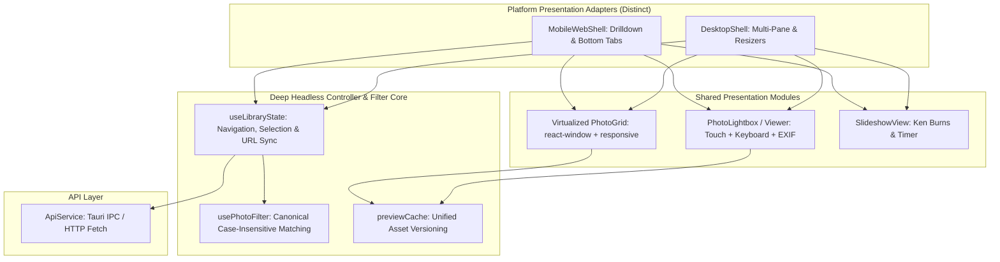

# DamRight: Unified Shell & Shared Navigation Core Spec

This document is the engineering hand-off specification for refactoring the desktop ([`src/App.tsx`](../../src/App.tsx)) and web ([`src/WebApp.tsx`](../../src/WebApp.tsx)) shells. It defines how to eliminate duplicate domain logic while **strictly preserving mobile phone SPA ergonomics and legitimate platform differences**.

---

## 1. Context & Motivation

### The Current Friction
Currently, `App.tsx` (922 lines) and `WebApp.tsx` (1,015 lines) are two completely independent applications that duplicate ~2,000 lines of React code:
- Both implement separate photo grid virtualization, resize observers, fullscreen photo viewers, touch/swipe handlers, EXIF info drawers, search inputs, slideshow lifecycles, and localStorage persistence.
- **Silent Logic Drift:**
  - **Tag filtering:** Web is case-insensitive; Desktop is case-sensitive.
  - **People filtering:** Web matches faces and falls back to tags (case-insensitive); Desktop only matches faces (case-sensitive).
  - **Preview cache keys:** Web includes `portrait_blur` and `orientation`; Desktop cache ignores them.

### Non-Negotiable Principle: Preserve Phone SPA Feel
The Web app is designed primarily for browsing from phones and tablets over a local home server. It must **retain its clean, native-feeling mobile SPA UX**:
- Top contextual navigation bar with drill-down back buttons.
- Touch swiping and tap-zone navigation in the full-screen photo viewer.
- Visual subfolder card grid for hierarchy drill-in on touchscreens.
- URL-driven slideshow routing (`/slideshow?interval=300&kenBurns=true`) and search history.
- Read-only simplicity (no editing sidebars, crop overlays, exposure sliders, or modal forms).

---

## 2. Defining the Seam: Distinct UX vs Shared Core



### 2.1 Legitimate Platform Differences (Keep Distinct)

| Feature | Desktop App (`DesktopShell`) | Mobile Web (`MobileWebShell`) |
|---|---|---|
| **Layout Paradigm** | 3-pane resizable layout (`Sidebar` + Center View + `MetadataPanel`). | Single-column mobile layout with contextual header & bottom navigation tabs. |
| **Folder Navigation** | Collapsible recursive tree view (`TreeView.tsx`) with instant path selection. | Drill-down navigation: tapping a folder renders subfolder visual cards and direct items with back chevron. |
| **Editing & Mutations** | Non-destructive crop/rotate, exposure, batch tagging, capture date shift, auto-rename, moving, deletions. | Read-only library browsing, tag inspection, and slideshow playback. |
| **Routing / State** | Desktop window lifecycle; state stored in `localStorage`. | Browser History API integration (`pushState`, URL query params `?query=...`, route `/slideshow`). |
| **Native Integrations** | Tauri native dialogs, Finder/Explorer reveal, native dock badge updates. | Browser native sharing / full-screen API. |

---

### 2.2 Shared Domain Core (To Unify)

1. **`useLibraryState` (Headless Controller)**:
   - Manages active tab (`folders`, `tags`, `people`, `quick`, `duplicates`, `validation`), selected folder/tag/person, search query, selected photo, and active photo collection.
   - Syncs state with `localStorage` (and optionally URL search params).
2. **Canonical `usePhotoFilter`**:
   - Single source of truth for library filtering.
   - Case-insensitive tag matching (`t.toLowerCase() === selectedTag.toLowerCase()`).
   - Case-insensitive person matching (`face.name.toLowerCase() === selectedPerson.toLowerCase()`).
   - Path prefix matching normalized across POSIX (`/`) and Windows (`\`) separators.
   - Sorting: Capture time ascending with deterministic path fallback.
3. **Unified `PhotoLightbox` (Full-Screen Viewer)**:
   - Replaces the separate lightboxes in `WebApp.tsx` and `PhotoPreview.tsx`.
   - Supports **both** keyboard shortcuts (`ArrowLeft`, `ArrowRight`, `Escape`) and **mobile touch swiping / edge tap zones**.
   - Built-in preview prefetching (`prefetchAdjacentPreviews`) and unified cache key resolution.
   - Slide-out/expandable EXIF inspection drawer.
4. **Unified `PhotoThumbnail` / `WebPhotoCell`**:
   - Single responsive thumbnail renderer with video duration badges, aspect-ratio handling, and cache-busting version fingerprints.

---

## 3. Target Module Design

### 3.1 Headless Controller: `src/hooks/useLibraryState.ts`

```typescript
export interface LibraryNavigationState {
  activeTab: 'photos' | 'folders' | 'tags' | 'people' | 'quick' | 'duplicates' | 'validation';
  selectedPath: string | null;
  selectedTag: string | null;
  selectedPerson: string | null;
  searchQuery: string;
  searchScope: 'global' | 'local';
  validationFilter: 'all' | 'missing_event' | 'missing_capture_time' | 'bad_name' | 'bad_folder';
}

export function useLibraryState(options?: { syncUrl?: boolean }) {
  // Encapsulates photo fetching, source loading, tag/people indexing,
  // navigation state transitions, drilldown/back helpers, and filtered collection derivation.
}
```

### 3.2 Shared Viewer: `src/components/common/PhotoLightbox.tsx`

```typescript
export interface PhotoLightboxProps {
  photo: Photo;
  photos: Photo[];
  currentIndex: number;
  isOpen: boolean;
  onClose: () => void;
  onNavigate: (newIndex: number) => void;
  showMetadataDrawer?: boolean;
  onTagClick?: (tag: string) => void;
  onPersonClick?: (person: string) => void;
}
```
*Handles touch swipes, arrow keys, prefetching, video playback, and EXIF display in one tested component.*

---

## 4. Step-by-Step Implementation Plan

### Step 1: Align Domain Filters in `usePhotoFilter.ts`
- Update `usePhotoFilter.ts` to enforce case-insensitive tag matching and normalize paths.
- Add unit tests in `src/hooks/usePhotoFilter.test.ts` verifying identical filtering across desktop and web test fixtures.

### Step 2: Extract `PhotoLightbox.tsx`
- Extract the touch-enabled, gesture-ready lightbox from `WebApp.tsx` into `src/components/common/PhotoLightbox.tsx`.
- Support responsive layout: compact full-screen on mobile viewports, centered modal with full keyboard controls on desktop.
- Add Vitest component tests in `src/test/PhotoLightbox.test.tsx`.

### Step 3: Extract `useLibraryState.ts`
- Combine common state management from `App.tsx` and `WebApp.tsx` into `src/hooks/useLibraryState.ts`.
- Provide helper methods: `selectFolder(path)`, `navigateBack()`, `selectTag(tag)`, `selectPerson(person)`, `clearSearch()`.

### Step 4: Refactor `WebApp.tsx` into `MobileWebShell`
- Replace inline filter loops, manual lightbox markup, and duplicate photo cell logic in `WebApp.tsx` with `useLibraryState` and `PhotoLightbox`.
- Keep the mobile header, subfolder cards (`web-subfolders-grid`), bottom navigation tabs, and URL history integration.
- `WebApp.tsx` reduces from **1,015 lines to ~250 lines**.

### Step 5: Refactor `App.tsx` into `DesktopShell`
- Replace redundant navigation state and preview viewer in `App.tsx` with `useLibraryState` and shared viewer.
- Keep resizable panels (`Sidebar`, `MetadataPanel`, `Resizer`), editing modals (`CropView`, `EditCaptureDateModal`, `MovePhotosModal`), and native Tauri event listeners.
- `App.tsx` reduces from **922 lines to ~350 lines**.

### Step 6: Automated Verification & E2E Tests
- Run existing E2E tests:
  - `npx playwright test e2e/app.test.ts` (Desktop app verification)
  - `npx playwright test e2e/mobile.test.ts` (Mobile touch and responsive verification)
- Run mandatory verification suite:
  ```bash
  npm run validate
  ```

---

## 5. Acceptance Criteria

- [ ] Mobile Web view retains its fast SPA feel: touch swipes, drill-down subfolder cards, and bottom tabs work seamlessly.
- [ ] Tag and person filtering behavior is 100% consistent across Desktop and Web.
- [ ] Fullscreen lightbox is a single shared component with full touch, mouse, and keyboard support.
- [ ] `App.tsx` and `WebApp.tsx` are thin presentation shells delegating to `useLibraryState`.
- [ ] No regression in Desktop editing workflows (Crop, Exposure, Batch Metadata, Move, Rename).
- [ ] All Vitest tests and Playwright E2E tests pass cleanly (`npm run validate`).
