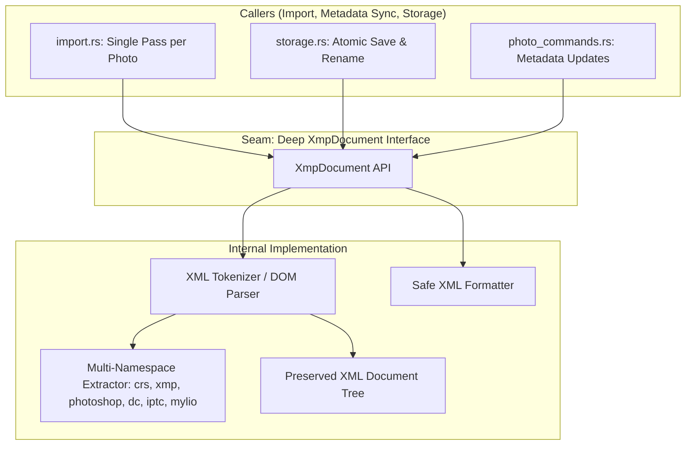

# DamRight: Single-Pass `XmpDocument` Parser & Synchronizer Spec

This document is the engineering hand-off specification for refactoring XMP sidecar handling into a deep, single-pass **`XmpDocument`** module. Any agent or engineer assigned to implement this task should follow this document as the authoritative blueprint.

---

## 1. Context & Motivation

### Core Mandate
In DamRight, `.xmp` sidecars are the **golden source of truth** for ratings, tags, non-destructive crop/rotation edits, exposure adjustments, events, and IPTC location metadata. Edits must be portable (compatible with Adobe Lightroom / Camera Raw, Mylio, Capture One) and **non-destructive** (third-party metadata namespaces must never be erased or corrupted).

### The Problem: Multi-Pass Disk I/O & Fragile Regex String Manipulation
Currently, [`src-tauri/src/processing/metadata/xmp.rs`](../../src-tauri/src/processing/metadata/xmp.rs) (673 lines) has two major architectural defects:

1. **Massive Redundant Disk I/O**:
   Every metadata extraction function:
   - `extract_crop_rotation`
   - `extract_location`
   - `extract_title_description`
   - `get_xmp_metadata`
   - `get_xmp_orientation`
   - `get_xmp_exposure`
   - `get_capture_time_xmp`
   - `get_preserved_filename`
   
   ...opens and reads the same `.xmp` sidecar file from disk independently. When importing or refreshing a library of 1,000 photos, the system performs **6,000 to 8,000 redundant file reads and string allocations**.

2. **Fragile Regex Writing**:
   Writing updates back to XMP sidecars (`sync_xmp_metadata`, `update_xmp_attribute`, `update_xmp_alt_block`) uses regex search-and-replace on raw XML text. If an external tool formats attributes across multiple lines or uses unconventional namespace prefixes, the regex replacements fail or corrupt the XML structure.

---

## 2. Deep Module Architecture



### Architectural Principles
- **Single Read, Complete Model**: When a photo is processed, its XMP sidecar is read from disk **exactly once**. All metadata fields are parsed into typed in-memory properties.
- **Non-Destructive Round-Tripping**: Unmodified namespaces, raw tags, and unknown vendor blocks (e.g. Photoshop history, custom camera profiles) are preserved verbatim when writing back changes.
- **The Interface is the Test Surface**: Unit tests pass raw XML strings into `XmpDocument::from_str` and assert extracted properties and serialized outputs without touching the filesystem.

---

## 3. Interface Design (`src-tauri/src/processing/metadata/xmp_document.rs`)

```rust
use std::path::{Path, PathBuf};
use chrono::NaiveDateTime;

#[derive(Debug, Clone, Default)]
pub struct LocationMetadata {
    pub city: Option<String>,
    pub state: Option<String>,
    pub country: Option<String>,
    pub location_name: Option<String>,
}

#[derive(Debug, Clone, Default)]
pub struct CropMetadata {
    pub top: Option<f64>,
    pub left: Option<f64>,
    pub bottom: Option<f64>,
    pub right: Option<f64>,
    pub angle: Option<f64>,
}

pub struct XmpDocument {
    raw_content: String,
    sidecar_path: Option<PathBuf>,
    
    // Extracted Domain Properties (Cached in Memory)
    pub rating: u8,
    pub tags: Vec<String>,
    pub event: Option<String>,
    pub title: Option<String>,
    pub description: Option<String>,
    pub capture_time: Option<NaiveDateTime>,
    pub orientation: Option<u8>,
    pub exposure: Option<f32>,
    pub portrait_blur: Option<f64>,
    pub crop: CropMetadata,
    pub location: LocationMetadata,
    pub preserved_filename: Option<String>,
}

impl XmpDocument {
    /// Load and parse the associated XMP sidecar for a given media file path.
    /// Returns None if no sidecar exists on disk.
    pub fn load_for_media(media_path: &Path) -> Option<Self>;

    /// Parse an XMP document from an in-memory XML string.
    pub fn from_str(xml: &str) -> anyhow::Result<Self>;

    /// Create a new blank standard XMP document template.
    pub fn new_empty() -> Self;

    // Mutators
    pub fn set_rating(&mut self, rating: u8);
    pub fn set_tags(&mut self, tags: &[String]);
    pub fn set_event(&mut self, event: Option<String>);
    pub fn set_title(&mut self, title: Option<String>);
    pub fn set_description(&mut self, description: Option<String>);
    pub fn set_exposure(&mut self, exposure: Option<f32>);
    pub fn set_portrait_blur(&mut self, blur: Option<f64>);
    pub fn set_crop(&mut self, crop: CropMetadata, photo_orientation: u8);
    pub fn set_capture_time(&mut self, dt: NaiveDateTime);
    pub fn set_preserved_filename(&mut self, filename: &str);

    /// Serialize the document to valid, well-formed XMP XML.
    pub fn to_xml(&self) -> String;

    /// Save the document to disk (atomically overwriting the sidecar).
    pub fn save_to_file(&self, path: &Path) -> anyhow::Result<()>;
}
```

---

## 4. Supported Schemas & Extraction Invariants

The single-pass parser must extract properties across standard industry namespaces:

### 4.1 Rating & Tags
- **Rating**: `<xmp:Rating>N</xmp:Rating>` or `xmp:Rating="N"` (0–5).
- **Tags (Keywords)**: `<dc:subject><rdf:Bag><rdf:li>tag1</rdf:li>...</rdf:Bag></dc:subject>` or `<dc:subject><rdf:Seq>`.

### 4.2 Non-Destructive Crop & Rotation
1. **Adobe Camera Raw (`crs:`) Standard**:
   - `crs:HasCrop="True"`
   - `crs:CropTop`, `crs:CropLeft`, `crs:CropBottom`, `crs:CropRight`, `crs:CropAngle`
2. **Mylio (`MY:`) Fallback**:
   - `MY:cropEnabled="True"`
   - `MY:cropTop`, `MY:cropLeft`, `MY:cropHeight`, `MY:cropWidth`, `MY:cropAspect`
3. **Orientation Transformation**:
   - Normalize raw crop coordinates to oriented coordinates via `raw_to_oriented_crop`.

### 4.3 Location & IPTC Extension
- **Flat Tags**: `photoshop:City`, `photoshop:State`, `photoshop:Country`, `photoshop:Location`.
- **IPTC Core**: `Iptc4xmpCore:City`, `Iptc4xmpCore:Province-State`, `Iptc4xmpCore:Country`.
- **IPTC Extension**: `<Iptc4xmpExt:LocationShown>`, `<Iptc4xmpExt:LocationCreated>`, `<Iptc4xmpExt:LocationName>`.

### 4.4 Title & Description
- Multi-language alternative bags: `<dc:title><rdf:Alt><rdf:li xml:lang="x-default">Title</rdf:li></rdf:Alt></dc:title>`
- Fallbacks: `photoshop:Headline`, `Iptc4xmpCore:ObjectName`, `dc:description`, `Iptc4xmpCore:Caption-Abstract`.

### 4.5 Capture Date
- `xmp:CreateDate`, `photoshop:DateCreated`, `exif:DateTimeOriginal` parsed via ISO 8601 / RFC 3339 / Exif datetime formats.

---

## 5. Step-by-Step Implementation Plan

### Step 1: Create `src-tauri/src/processing/metadata/xmp_document.rs`
- Implement `XmpDocument` with single-pass parsing of all namespaces.
- Implement structured XML serialization that updates only edited nodes while keeping the rest of `rdf:Description` intact.
- Expose `pub mod xmp_document;` in `src-tauri/src/processing/metadata/mod.rs`.

### Step 2: Refactor `src-tauri/src/processing/metadata/xmp.rs`
- Re-implement all public helper functions in `xmp.rs` as thin adapters over `XmpDocument`:
  ```rust
  pub fn get_xmp_metadata(path: &Path) -> (u8, String, Option<String>) {
      if let Some(doc) = XmpDocument::load_for_media(path) {
          (doc.rating, doc.tags.join(","), doc.event)
      } else {
          (0, String::new(), None)
      }
  }
  ```
- This preserves backward compatibility for any callers not yet updated.

### Step 3: Refactor Importer & Refresh (`src-tauri/src/processing/import.rs`)
- During folder scanning and metadata sync in `import_folder` and `refresh_folder`, load `let xmp_doc = XmpDocument::load_for_media(path)` once per photo.
- Populate all photo fields (rating, tags, event, title, description, crop, orientation, location) in a single step from `xmp_doc`.

### Step 4: Refactor Sync & Storage Writers
- Update `sync_xmp_metadata` and `AssetStorage::auto_rename_photo` to load `XmpDocument`, apply mutations, and call `doc.save_to_file(&xmp_path)`.

### Step 5: Automated Unit Tests
In `src-tauri/src/processing/metadata/xmp_document.rs` (or `xmp_tests.rs`):
- **Test 1 (`test_adobe_camera_raw_roundtrip`)**: Parse Adobe Lightroom XMP sample with crop, rating, tags, and custom CRS attributes $\rightarrow$ mutate rating and tags $\rightarrow$ verify custom CRS attributes remain untouched and XML is well-formed.
- **Test 2 (`test_mylio_crop_extraction`)**: Parse Mylio crop format with `MY:cropAspect` and `MY:cropHeight` $\rightarrow$ verify coordinates match expected oriented bounding box.
- **Test 3 (`test_iptc_location_extension_extraction`)**: Parse IPTC Extension `<Iptc4xmpExt:LocationShown>` $\rightarrow$ verify city, state, country, and location name are parsed accurately.
- **Test 4 (`test_single_pass_performance`)**: Benchmark / assert that parsing 500 sidecars in memory executes in milliseconds without disk thrashing.

### Step 6: Mandatory Verification Suite
Run the full verification suite:
```bash
npm run validate
```
Ensure all TypeScript checks, Vitest frontend tests, Playwright E2E tests, and Cargo tests pass with exit code 0.

---

## 6. Acceptance Criteria

- [ ] Reading sidecar metadata for a photo executes at most **1 file read** per photo.
- [ ] Third-party XML namespaces (e.g. Adobe Lightroom, Mylio, Capture One) are completely preserved during metadata write-back.
- [ ] All existing XMP unit tests in `src-tauri/src/processing/metadata/xmp.rs` continue to pass.
- [ ] Importer (`import.rs`) and folder refresh (`refresh_folder`) populate all metadata fields via `XmpDocument` in a single pass.
- [ ] `npm run validate` runs cleanly with zero regressions.
